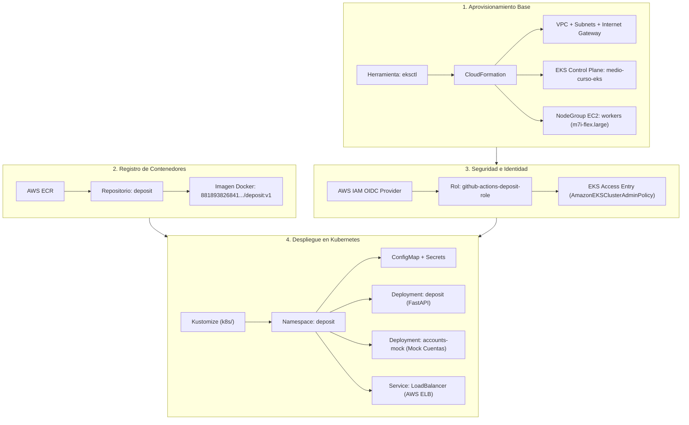
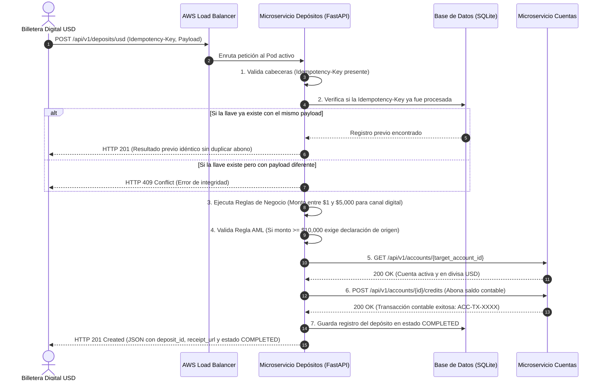
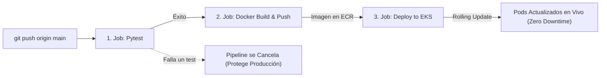

# 📘 Guía Técnica Completa de Arquitectura, Despliegue y Sustentación
## Microservicio Bancario de Depósitos en Dólares (`usd-deposit-service`)

> **Propósito del Documento:**  
> Este documento sirve como guía de estudio, referencia técnica y libreto de sustentación académica y profesional. Explica en detalle cómo se diseñó, construyó, aseguró y desplegó el microservicio en **Amazon Web Services (AWS)** con **Kubernetes (EKS)** y **CI/CD con GitHub Actions**.

---

## 📑 Tabla de Contenidos
1. [Ficha Técnica del Proyecto](#1-ficha-técnica-del-proyecto)
2. [¿Cómo se Levantó el Servicio? (Paso a Paso)](#2-cómo-se-levantó-el-servicio-paso-a-paso)
3. [Arquitectura del Software (Código y Patrones)](#3-arquitectura-del-software-código-y-patrones)
4. [Flujos del Sistema (Diagramas y Casos de Uso)](#4-flujos-del-sistema-diagramas-y-casos-de-uso)
5. [Seguridad Implementada (Cloud, Contenedor y Negocio)](#5-seguridad-implementada)
6. [Resiliencia y Alta Disponibilidad](#6-resiliencia-y-alta-disponibilidad)
7. [Guía Rápida para la Exposición / Sustentación](#7-guía-rápida-para-la-exposición--sustentación)

---

## 1. Ficha Técnica del Proyecto

| Componente | Tecnología / Estándar | Justificación |
| :--- | :--- | :--- |
| **Lenguaje** | Python 3.11 | Rápido desarrollo, soporte asíncrono nativo (`async/await`) y tipado estático moderno. |
| **Framework Web** | FastAPI (ASGI con Uvicorn) | Alto rendimiento (comparable con NodeJS y Go), validación automática y generación de OpenAPI 3.1 en tiempo real. |
| **Base de Datos** | SQLite Asíncrono (`aiosqlite` + SQLAlchemy 2.0) | Persistencia ACID relacional ligera, con volumen persistente en disco sin bloqueo de eventos I/O. |
| **Contenedores** | Docker (Multi-stage build) | Empaquetado inmutable, imágenes ultra ligeras (~75 MB) y ejecución segura sin permisos de administrador (non-root UID 1000). |
| **Orquestador** | AWS EKS (Kubernetes v1.34) | Estándar de la industria para microservicios distribuidos: auto-recuperación, escalamiento horizontal y balanceo de tráfico. |
| **Registro de Imágenes** | AWS ECR (Elastic Container Registry) | Almacenamiento privado, cifrado y de baja latencia dentro del centro de datos de AWS (`us-east-1`). |
| **Balanceador de Carga** | AWS Elastic Load Balancer (ELB) | Exposición pública en Internet con puerto 80 redirigiendo internamente hacia los Pods en puerto 8000. |
| **Pipeline CI/CD** | GitHub Actions | Automatización integral: ejecución de pruebas unitarias, compilación Docker y despliegue a Kubernetes con cada `git push`. |
| **Autenticación Cloud** | OpenID Connect (OIDC Keyless) | Máxima seguridad en la nube: conexión entre GitHub y AWS sin almacenar contraseñas ni Access Keys fijas. |

---

## 2. ¿Cómo se Levantó el Servicio? (Paso a Paso)

El despliegue del ecosistema se realizó siguiendo las mejores prácticas de **Infraestructura como Código (IaC)** y **GitOps**.



### Paso 1: Creación del Clúster EKS con `eksctl`
Se utilizó la herramienta oficial `eksctl` para generar automáticamente los Stacks de AWS CloudFormation:
- Se creó una red virtual aislada (**VPC**) con subredes públicas y privadas en la región `us-east-1` (Norte de Virginia).
- Se levantó el **Control Plane** de Kubernetes administrado por AWS (versión 1.34).
- Se asoció un grupo de cómputo (**NodeGroup**) con instancias EC2 de alto rendimiento (`m7i-flex.large`), equipadas con addons esenciales como `vpc-cni` (redes de pods), `kube-proxy`, `coredns` y `metrics-server`.

### Paso 2: Construcción y Publicación de la Imagen en AWS ECR
1. Se programó un `Dockerfile` en dos etapas (**Multi-stage build**):
   - **Etapa 1 (builder):** Instala los compiladores de C y paquetes de Python en un directorio local.
   - **Etapa 2 (runner):** Copia únicamente los binarios requeridos a una imagen limpia de `python:3.11-slim`, desechando herramientas de compilación para reducir el peso y eliminar vectores de ataque.
2. Se autenticó localmente con AWS ECR y se publicó la imagen con etiqueta `:v1`.

### Paso 3: Configuración de la Identidad Federada (OIDC)
Para conectar GitHub Actions con AWS de forma profesional y segura:
- Se activó el proveedor de identidad **OIDC de GitHub** en AWS IAM (`token.actions.githubusercontent.com`).
- Se creó el rol `github-actions-deposit-role` con una política de confianza que **únicamente** autoriza solicitudes provenientes de tu repositorio exacto (`repo:RengiCodeMaster/microservicio:*`).
- Se vinculó el rol a EKS usando las modernas **Access Entries** de Kubernetes de AWS, otorgando permisos de administración sin tocar el archivo obsoleto `aws-auth`.

### Paso 4: Despliegue de los Manifiestos de Kubernetes con Kustomize
Mediante la carpeta `k8s/` y el comando `kubectl apply -k k8s/`, se crearon en orden:
1. **`namespace.yaml`**: Crea el espacio de nombres aislado `deposit`.
2. **`configmap.yaml`**: Inyecta configuraciones desacopladas (variables financieras, URL del servicio de cuentas, nivel de logs).
3. **`deployment.yaml`**: Declara el Pod de la aplicación con:
   - Probes de salud HTTP (`/health/live` y `/health/ready`).
   - Límites y solicitudes de CPU y Memoria (Requests: 100m / 128Mi, Limits: 500m / 512Mi).
   - Volumen de datos montado en `/app/data` para que la base de datos SQLite no pierda datos al reiniciarse el pod.
4. **`service.yaml`**: Solicita a AWS la creación de un **Elastic Load Balancer (ELB)** público que asigna una dirección DNS mundialmente accesible (`http://a79e...elb.amazonaws.com`).
5. **`accounts-mock.yaml`**: Despliega un mock interno en el puerto 8081 que emula el servicio de cuentas bancarias para permitir pruebas funcionales completas.

---

## 3. Arquitectura del Software (Código y Patrones)

El proyecto sigue rigurosamente los principios de **Clean Architecture (Arquitectura Limpia / Puertos y Adaptadores)** y los lineamientos de **12-Factor App**:

```
microservicio/
├── src/
│   ├── api/             # Capa de Entrada / Adaptadores Primarios (REST)
│   │   ├── v1/deposits.py   # Controlador del endpoint POST /api/v1/deposits/usd
│   │   ├── health.py        # Sondas /health/live y /health/ready
│   │   └── dependencies.py  # Inyección de dependencias (FastAPI Depends)
│   ├── domain/          # Núcleo del Negocio (Independiente de la infraestructura)
│   │   ├── models.py        # Modelos de dominio puros y tipos de datos
│   │   └── rules.py         # Reglas financieras (límites de montos, reglas AML)
│   ├── services/        # Capa de Aplicación / Casos de Uso
│   │   └── deposit_service.py # Orquestación del flujo de depósito, idempotencia y auditoría
│   ├── infrastructure/  # Capa de Adaptadores Secundarios (Salida)
│   │   ├── db_models.py     # Tablas ORM de base de datos
│   │   ├── deposit_repository.py      # Persistencia de transacciones
│   │   ├── idempotency_repository.py  # Control de llaves de idempotencia
│   │   └── clients/accounts_client.py # Cliente HTTP asíncrono con Circuit Breaker
│   └── core/            # Configuración transversal
│       ├── config.py        # Variables de entorno validadas con Pydantic Settings
│       ├── database.py      # Motor y sesiones asíncronas de SQLAlchemy
│       ├── exceptions.py    # Excepciones de dominio mapeadas a RFC 7807
│       └── logging.py       # Logger JSON estructurado con correlación
```

### Ventajas de este Diseño:
- **Testabilidad:** El núcleo de negocio (`domain` y `services`) no depende de la base de datos ni de AWS; puede probarse con pruebas unitarias en milisegundos.
- **Desacoplamiento:** Si en el futuro cambiamos la base de datos de SQLite a PostgreSQL, solo se modifica `infrastructure/`, el resto del sistema queda intacto.
- **Formato Estándar de Errores (RFC 7807):** Toda falla devuelve un JSON con `type`, `title`, `status`, `detail`, `code` y `correlation_id`, evitando respuestas genéricas no informativas.

---

## 4. Flujos del Sistema (Diagramas y Casos de Uso)

### Flujo 1: Petición de Depósito desde Billetera Digital USD
Este es el flujo principal de integración cuando un compañero o cliente realiza un depósito:



---

### Flujo 2: El Principio de Idempotencia Financiera
En banca por Internet, si un usuario sufre un micro-corte de Wi-Fi justo después de hacer clic en "Depositar", su aplicación reintentará enviar el paquete.
* **Sin Idempotencia:** El banco descontaría o acreditaría el dinero 2 veces.
* **Con Idempotencia (Nuestro Microservicio):**
  1. Cada petición debe incluir la cabecera `Idempotency-Key: <UUIDv4>`.
  2. Nuestro sistema calcula un hash SHA-256 del cuerpo del mensaje y lo almacena junto a la llave.
  3. Si llega un reintento idéntico, el microservicio **no vuelve a tocar el servicio de cuentas ni a duplicar dinero**: retorna de inmediato la respuesta guardada de la primera transacción.

---

### Flujo 3: El Pipeline de CI/CD (GitHub Actions)
Cada vez que el equipo realiza un `git push origin main`:



1. **Job 1: Tests Unitarios:** Ejecuta `pytest` sobre todo el código fuente en un contenedor limpio de Ubuntu. Si falla una prueba, el despliegue se detiene de inmediato.
2. **Job 2: Compilación y Push a ECR:** Se conecta a AWS usando OIDC, compila la imagen Docker con el hash del commit y la sube al repositorio ECR.
3. **Job 3: Despliegue en EKS:** Descarga el `kubeconfig` de AWS, actualiza la imagen del deployment con `kubectl set image` o `kustomize` y espera que el nuevo pod pase las pruebas de salud antes de retirar el anterior.

---

## 5. Seguridad Implementada

### A. Seguridad en la Nube (Cloud & IAM)
- **Cero Credenciales Estáticas (Keyless CI/CD):** No existen contraseñas ni `AWS_SECRET_ACCESS_KEY` guardadas en GitHub. Usamos **OIDC**, donde AWS emite tokens criptográficos efímeros válidos solo por 15 minutos.
- **Acceso por Lista Blanca:** El rol de IAM solo permite peticiones desde la rama `main` del repositorio `RengiCodeMaster/microservicio`.
- **EKS Access Entries:** Acceso granular basado en RBAC nativo de Kubernetes.

### B. Seguridad en Contenedores (Docker & Linux)
- **Ejecución como Usuario No-Root (`appuser` UID 1000):** Por defecto, un contenedor corre como `root`. Si un atacante vulnerara la aplicación, tendría privilegios de administrador en el host. Nuestro contenedor corre bajo un usuario sin privilegios.
- **Reducción de Superficie de Ataque:** Al usar compilación multi-etapa, la imagen final no incluye compiladores (`gcc`), herramientas de desarrollo ni gestores de paquetes que un atacante pudiera usar para descargar malware.

### C. Seguridad Bancaria y Cumplimiento Normativo (Fintech)
- **Prevención de Lavado de Activos (AML - Anti-Money Laundering):**
  - Depósitos unitarios $\ge \$10,000.00$ USD requieren obligatoriamente una declaración jurada del origen de los fondos (`aml_declaration`).
  - Límite acumulado diario por cliente fijado en $\$20,000.00$ USD.
- **Límites por Canal:** Para canales digitales (`PARTNER`, `WEB`), el límite por transacción es de $\$5,000.00$ USD; transacciones mayores solo se autorizan en ventanilla física (`BRANCH`).
- **Trazabilidad Distribuida (`X-Correlation-Id`):** Cada petición recibe o genera un identificador único que se propaga en los logs y en las llamadas a microservicios hermanos, permitiendo auditar fraudes o caídas entre sistemas distribuidos.

---

## 6. Resiliencia y Alta Disponibilidad

### 1. Patrón Circuit Breaker (Disyuntor)
El cliente `AccountsServiceClient` incluye un disyuntor automático:
- **Estado CERRADO (`CLOSED`):** Tráfico normal hacia el microservicio de Cuentas.
- **Estado ABIERTO (`OPEN`):** Si el servicio de Cuentas falla 3 veces consecutivas por timeout o caída, el disyuntor se "abre" durante 30 segundos. Durante ese tiempo, las peticiones entrantes son rechazadas de inmediato sin esperar 5 segundos de timeout, evitando que los hilos del servidor se agoten.
- **Estado SEMI-ABIERTO (`HALF-OPEN`):** Pasado el tiempo de enfriamiento, permite pasar una petición de prueba. Si responde exitosamente, el disyuntor se vuelve a cerrar.

### 2. Sondas de Salud de Kubernetes (Probes)
- **Liveness Probe (`/health/live`):** Verifica cada 10 segundos que el proceso de FastAPI esté vivo. Si el hilo principal se congela en un bucle infinito, Kubernetes destruye el Pod y levanta uno nuevo automáticamente.
- **Readiness Probe (`/health/ready`):** Verifica que la base de datos responda y que el circuito no esté saturado. Si el pod está sobrecargado, el balanceador de carga deja de enviarle tráfico hasta que se recupere.

---

## 7. Guía Rápida para la Exposición / Sustentación

Si el profesor o evaluador te hace preguntas clave, aquí tienes las respuestas directas:

### P1: ¿Por qué usaron Kubernetes (EKS) en lugar de una simple máquina virtual EC2?
> **Respuesta:** *"Porque Kubernetes nos brinda auto-recuperación (self-healing), balanceo de carga nativo y despliegues sin caída de servicio (zero-downtime rolling updates). Si el contenedor falla, Kubernetes lo reinicia en segundos. Además, nos permite aislar dependencias y escalar horizontalmente el microservicio de forma elástica."*

### P2: ¿Cómo resolvieron la autenticación en el CI/CD de GitHub Actions?
> **Respuesta:** *"Implementamos OpenID Connect (OIDC) federado con AWS IAM. No guardamos llaves fijas ni contraseñas en los secretos de GitHub, lo que elimina el riesgo de fuga de credenciales. GitHub solicita un token JWT firmado y AWS STS le concede un rol temporal de mínimos privilegios solo mientras corre el pipeline."*

### P3: ¿Cómo evitan que una transacción se duplique si el cliente tiene problemas de conexión?
> **Respuesta:** *"Mediante el uso estricto de Idempotencia. El cliente envía un UUID único en la cabecera `Idempotency-Key`. Nuestro servicio guarda el hash de la transacción; si la petición se reintenta, el sistema detecta la llave existente y devuelve la misma confirmación contable anterior sin volver a impactar el saldo en el microservicio de cuentas."*

### P4: ¿Qué sucede si el microservicio de Cuentas externo se cae o está lento?
> **Respuesta:** *"Implementamos el patrón Circuit Breaker en el cliente HTTP. Si el servicio de Cuentas falla reiteradamente, el circuito se abre para evitar saturar de peticiones en espera a nuestra propia aplicación, respondiendo con un error HTTP 503 estandarizado bajo el RFC 7807 y protegiendo la estabilidad del clúster."*

### P5: ¿Qué medidas de seguridad tiene el contenedor Docker?
> **Respuesta:** *"Utilizamos compilación Multi-stage para que la imagen final solo contenga las librerías estrictamente necesarias (pesa solo 75 MB). Además, el contenedor se ejecuta bajo un usuario no-root con UID 1000 (`appuser`), garantizando que incluso ante una vulnerabilidad en el código, el atacante no obtenga privilegios de administrador sobre el nodo del clúster."*
