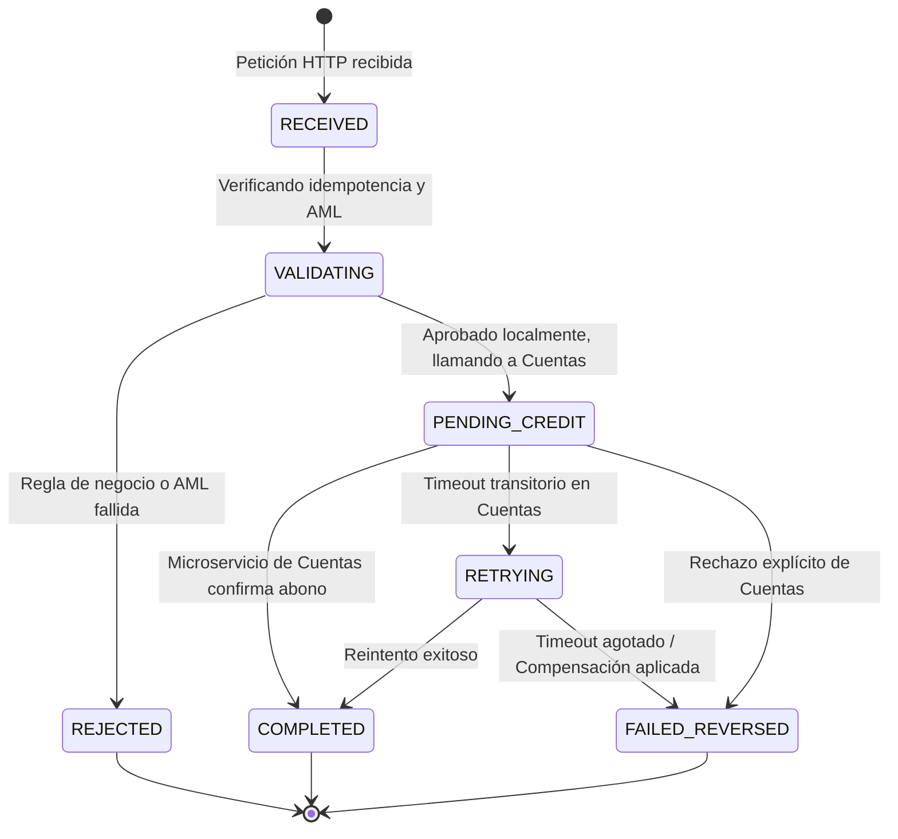

# SPEC-01: Dominio de Negocio y Reglas Financieras (Depósito en Dólares)

## 1. Visión General

El **Microservicio de Depósitos en Dólares (USD Deposit Service)** es responsable del ciclo de vida completo de captación y acreditación de fondos en moneda extranjera (USD) hacia cuentas bancarias de la institución. Opera bajo estándares financieros de auditoría, trazabilidad y cumplimiento normativo.

---

## 2. Tipos de Operaciones Soportadas

1. **DEP_CASH_USD (Efectivo por Ventanilla / ATM):**
   - Depósito de billetes físicos en dólares.
   - Requiere validación de origen en canal físico (`BRANCH` o `ATM_DEPOSIT`).
2. **DEP_TRANSFER_USD (Transferencia Interbancaria / Externa):**
   - Fondos provenientes de redes interbancarias (ACH, SWIFT/Wire, transferencias inmediatas).
   - Requiere `routing_number` o `swift_code` y número de referencia bancario de origen.

---

## 3. Matriz de Estados de la Transacción



### Definición de Estados:

- **`RECEIVED`**: Petición registrada en base de datos con clave de idempotencia reservada.
- **`VALIDATING`**: Evaluando validaciones de moneda, límites y políticas antifraude/AML.
- **`PENDING_CREDIT`**: Esperando respuesta del Microservicio de Cuentas tras enviar la orden de abono.
- **`COMPLETED`**: Saldo acreditado con éxito en la cuenta destino. Transacción finalizada.
- **`REJECTED`**: La transacción no procedió (cuenta bloqueada, cuenta en otra divisa no autorizada, monto excede límites, cliente inactivo).
- **`FAILED_REVERSED`**: Ocurrió un error no recuperable al llamar al servicio de Cuentas; se anula la transacción local y se notifica al canal.

---

## 4. Reglas de Negocio Estrictas

### 4.1. Moneda y Precisión

- **Moneda de destino obligatoria**: `USD` (ISO 4217).
- Si la cuenta destino no es bimonetaria o no es una cuenta en USD, la operación se rechaza con código `ACCOUNT_CURRENCY_MISMATCH`.
- **Precisión numérica**: 2 decimales fijos (`NUMERIC(15, 2)`). No se permiten fracciones de centavo.

### 4.2. Límites y Cumplimiento Normativo (AML / PLD)

- **Monto mínimo por operación**: `$ 1.00 USD`.
- **Monto máximo por operación (Canal Digital)**: `$ 5,000.00 USD`.
- **Monto máximo por operación (Ventanilla / Branch)**: `$ 50,000.00 USD`.
- **Regla UIA / AML (Prevención de Lavado de Activos)**:
  - Operaciones individuales iguales o superiores a `$ 10,000.00 USD` disparan flag `requires_aml_declaration: true` y requieren un número de formulario de declaración jurada (`aml_form_id`). Si no está presente, se rechaza con `AML_DECLARATION_REQUIRED`.
- **Límite diario acumulado por cuenta**: `$ 20,000.00 USD` (en las últimas 24 horas continuas).

### 4.3. Política de Idempotencia Estricta

- Toda petición `POST` debe incluir el header `X-Idempotency-Key` (formato UUIDv4).
- Ventana de validez: **24 horas**.
- Si se recibe la misma clave con el mismo payload exacto: se retorna la respuesta almacenada sin reejecutar la lógica financiera.
- Si se recibe la misma clave con un payload distinto (distinto monto, cuenta o referencia): se rechaza de inmediato con `409 Conflict` (`IDEMPOTENCY_CONFLICT`).

---

## 5. Integración con el Microservicio de Cuentas

### 5.1. Consulta Previa (`GET /api/v1/accounts/{account_id}`)

Debe validar que

- `status == "ACTIVE"`.
- `currency in ["USD", "MULTI_CURRENCY"]`.
- `allows_deposits == true`.
- `is_frozen == false`.

### 5.2. Orden de Acreditación (`POST /api/v1/accounts/{account_id}/credits`)

- Payload enviado:
  ```json
  {
    "transaction_reference": "DEP-USD-2026-98124",
    "amount": 2500.00,
    "currency": "USD",
    "source_system": "MS_DEPOSITS_USD",
    "description": "Depósito en ventanilla USD"
  }
  ```
- Estrategia de fallo: Si la llamada devuelve timeout (504) o error de red, el microservicio entra en reintentos con backoff. Si se agota, pasa a compensación / cola de conciliación.
