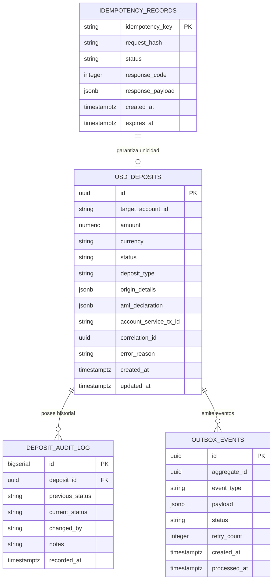

# SPEC-03: Arquitectura de Datos y Esquema Relacional (PostgreSQL)

## 1. Principios de Persistencia Financiera
1. **Precisión Numérica Estricta**: Todo campo monetario utiliza `NUMERIC(15, 2)` con constraint `CHECK (amount > 0)`. Queda estrictamente prohibido el uso de `FLOAT` o `DOUBLE`.
2. **Inmutabilidad y Auditoría (Append-Only)**: Los estados de depósitos no se sobreescriben sin registrar una fila histórica en `deposit_audit_log`.
3. **Control de Idempotencia y Concurrencia**: Manejo de bloqueo optimista / pesimista (`SELECT FOR UPDATE`) para evitar condiciones de carrera por dobles clics o reintentos de red.
4. **Patrón Transactional Outbox**: Garantiza que eventos de notificación o conciliación no se pierdan si se integra un broker (RabbitMQ/Kafka) en la nube.

---

## 2. Diagrama Entidad-Relación



---

## 3. Definición DDL (SQL PostgreSQL 15+)

```sql
CREATE EXTENSION IF NOT EXISTS "uuid-ossp";

-- 1. Tabla Principal de Depósitos en Dólares
CREATE TABLE IF NOT EXISTS usd_deposits (
    id UUID PRIMARY KEY DEFAULT uuid_generate_v4(),
    target_account_id VARCHAR(64) NOT NULL,
    amount NUMERIC(15, 2) NOT NULL CHECK (amount > 0),
    currency VARCHAR(3) NOT NULL DEFAULT 'USD' CHECK (currency = 'USD'),
    status VARCHAR(32) NOT NULL DEFAULT 'RECEIVED' 
        CHECK (status IN ('RECEIVED', 'VALIDATING', 'PENDING_CREDIT', 'COMPLETED', 'REJECTED', 'FAILED_REVERSED')),
    deposit_type VARCHAR(32) NOT NULL 
        CHECK (deposit_type IN ('DEP_CASH_USD', 'DEP_TRANSFER_USD')),
    origin_details JSONB NOT NULL DEFAULT '{}'::jsonb,
    aml_declaration JSONB NULL,
    account_service_tx_id VARCHAR(128) NULL,
    correlation_id UUID NOT NULL,
    error_reason TEXT NULL,
    created_at TIMESTAMPTZ NOT NULL DEFAULT CURRENT_TIMESTAMP,
    updated_at TIMESTAMPTZ NOT NULL DEFAULT CURRENT_TIMESTAMP
);

-- Índices estratégicos
CREATE INDEX idx_usd_deposits_account_date 
    ON usd_deposits (target_account_id, created_at DESC);

CREATE INDEX idx_usd_deposits_status 
    ON usd_deposits (status) WHERE status IN ('RECEIVED', 'PENDING_CREDIT');

-- 2. Tabla de Idempotencia
CREATE TABLE IF NOT EXISTS idempotency_records (
    idempotency_key VARCHAR(128) PRIMARY KEY,
    request_hash VARCHAR(64) NOT NULL,
    status VARCHAR(20) NOT NULL CHECK (status IN ('PROCESSING', 'COMPLETED', 'FAILED')),
    response_code INTEGER NULL,
    response_payload JSONB NULL,
    created_at TIMESTAMPTZ NOT NULL DEFAULT CURRENT_TIMESTAMP,
    expires_at TIMESTAMPTZ NOT NULL
);

CREATE INDEX idx_idempotency_expiry ON idempotency_records (expires_at);

-- 3. Tabla Inmutable de Auditoría
CREATE TABLE IF NOT EXISTS deposit_audit_log (
    id BIGSERIAL PRIMARY KEY,
    deposit_id UUID NOT NULL REFERENCES usd_deposits(id) ON DELETE RESTRICT,
    previous_status VARCHAR(32) NULL,
    current_status VARCHAR(32) NOT NULL,
    changed_by VARCHAR(64) NOT NULL DEFAULT 'SYSTEM',
    notes TEXT NULL,
    recorded_at TIMESTAMPTZ NOT NULL DEFAULT CURRENT_TIMESTAMP
);

CREATE INDEX idx_audit_deposit_id ON deposit_audit_log (deposit_id);

-- 4. Tabla Outbox para Consistencia Eventual en la Nube
CREATE TABLE IF NOT EXISTS outbox_events (
    id UUID PRIMARY KEY DEFAULT uuid_generate_v4(),
    aggregate_id UUID NOT NULL,
    event_type VARCHAR(64) NOT NULL,
    payload JSONB NOT NULL,
    status VARCHAR(20) NOT NULL DEFAULT 'PENDING' CHECK (status IN ('PENDING', 'SENT', 'FAILED')),
    retry_count INTEGER NOT NULL DEFAULT 0,
    created_at TIMESTAMPTZ NOT NULL DEFAULT CURRENT_TIMESTAMP,
    processed_at TIMESTAMPTZ NULL
);

CREATE INDEX idx_outbox_pending ON outbox_events (status, created_at) WHERE status = 'PENDING';
```

---

## 4. Query de Verificación de Límite Diario Acumulado
Antes de aprobar la acreditación, el servicio ejecuta:
```sql
SELECT COALESCE(SUM(amount), 0.00) AS total_today
FROM usd_deposits
WHERE target_account_id = :target_account_id
  AND status = 'COMPLETED'
  AND created_at >= (NOW() - INTERVAL '24 HOURS');
```
Si `total_today + :new_amount > 20000.00`, la transacción es rechazada con `ERR_DAILY_LIMIT_EXCEEDED`.
