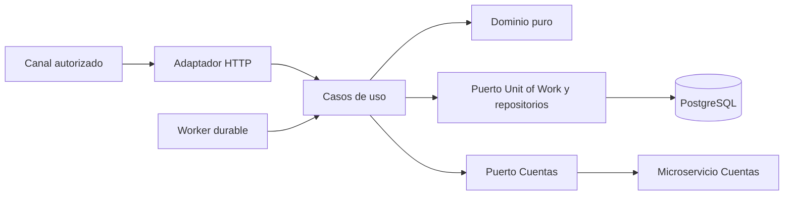

# SPEC-06 — Arquitectura y guía de construcción

Versión: 2.1. Define responsabilidades, no obliga a conservar nombres del código actual.

## 1. Arquitectura (ARC-001)



Dominio no importa FastAPI, SQLAlchemy, httpx, settings ni transporte. Casos de uso dependen de puertos, no de implementaciones. Adaptadores realizan traducción HTTP/SQL y wiring. API y worker reutilizan procesamiento y reglas; no duplican lógica de límites o terminalización.

Stack objetivo: Python 3.12, FastAPI/Pydantic 2, SQLAlchemy 2 async, asyncpg, httpx, PostgreSQL 15+, migraciones Alembic. Versiones exactas se fijan en lockfile al implementar. No convertir una actualización de dependencias en una decisión automática de dominio.

## 2. Componentes y contratos internos (ARC-002)

| Componente | Responsabilidad / salida |
| --- | --- |
| Deposit | Identidad, dinero, estado y versión; valida transiciones permitidas. |
| MonetaryPolicy | Snapshot inmutable de reglas y evaluación de límites locales/AML. |
| OriginEvidence | Variante física o bancaria, identidad de deduplicación. |
| AuthContext | Institución, sujeto, scopes, canales/orígenes/cuentas autorizados. |
| CreateDeposit | Resolver idempotencia, T1, ejecutar oportunistamente y persistir respuesta inicial. |
| ProcessDeposit | Validar cuenta, reservar, enviar crédito y aplicar resultado. |
| GetDeposit / ListDeposits / GetReceipt | Autorización de lectura y proyección pública. |
| RequestReconciliation | Autorizar, registrar solicitud y activar trabajo existente. |
| ReconcileDeposit | Consultar evidencia externa y recuperar con referencia estable. |
| UnitOfWork | begin/commit/rollback explícitos, repositorios dentro del mismo contexto. |
| DepositRepository | Leer por institución, guardar con expected_version, búsqueda paginada. |
| LimitRepository | Bloquear cuenta, calcular consumo y gestionar reserva. |
| IdempotencyRepository | Insertar único, leer registro, guardar respuesta, conservar tombstone. |
| JobRepository | Reclamar, renovar lease y aplicar sólo generation vigente. |
| AccountsPort | get_account, credit, lookup_credit; devuelve resultados tipados. |
| Clock / UUIDProvider | Instantes y IDs controlables en pruebas; decisiones de cupo usan reloj DB. |

AccountsPort distingue Success, DefinitiveRejection, Processing, NotFound, TransientFailure, UnknownOutcome y ContractFailure. UnknownOutcome no es excepción de negocio. Infraestructura valida contrato antes de emitir Success. No sintetiza transaction_id.

## 3. Organización sugerida

```text
src/
  domain/          # Entidades, políticas, enums, resultados
  application/     # Casos de uso y puertos
  adapters/
    http/          # Rutas, DTO, auth, Problem Details
    persistence/   # ORM, repositorios, UoW, jobs
    accounts/      # Cliente, autenticación, breaker
  bootstrap/       # Configuración y composición
  main.py          # Entrada API
  worker.py        # Entrada worker
migrations/
contracts/
  openapi.yaml
tests/
  unit/
  contract/
  integration/
  recovery/
```

Se permite adaptar carpetas existentes si se conservan dirección de dependencias y responsabilidades. No implementar modelos de dominio como ORM ni realizar commit desde routers. Errores del dominio se traducen a catálogo en un único adaptador.

## 4. Secuencia de construcción (ARC-003)

1. Contratos: OpenAPI, fixture de identidades y mock de Cuentas.
2. Dominio: dinero, variantes, estados y evaluación de políticas.
3. Datos: migraciones, unicidad, auditoría, reservas y leases.
4. Aplicación: creación, idempotencia, consulta, comprobante.
5. Integración: cliente resiliente y confirmación externa.
6. Worker: recuperación, conciliación manual, cierre de PROCESSING abandonado.
7. Seguridad/operación: JWT, observabilidad, contenedores y runbook.
8. Aceptación completa SPEC-07, evidencia documentada.

Cada etapa debe ser revisable con requisitos/pruebas correspondientes. Mock de éxito no sustituye pruebas de crash/concurrencia. El proyecto está construido cuando cumple SPEC-07/08 y dependencias externas están declaradas, no sólo porque inicia FastAPI.

## 5. Cambios prohibidos sin decisión documentada

Sustituir PostgreSQL por SQLite en pruebas de locks; liberar reservas por timeout; reenviar con ID nuevo; aceptar floats; inferir éxito de HTTP 200 sin validar body; poner jobs sólo en BackgroundTasks; cambiar estado por instrucción administrativa; acceder a todas las instituciones en un repositorio genérico.
